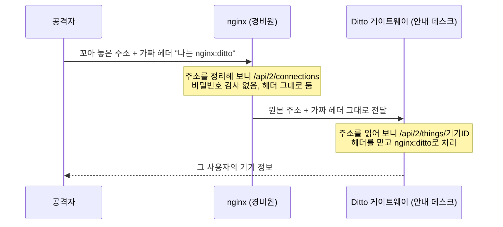

제가 찾아서 제보한 취약점이 **CVE-2026-135150**으로 등록됐습니다. 이 글은 그 취약점이 무엇이고, 왜 생겼고, 어떤 피해가 가능하며, 어떻게 막아야 하는지를 정리한 것입니다. 보안을 잘 모르는 분도 읽을 수 있도록 비유를 먼저 들고, 그다음에 실제 기술 내용을 설명합니다.

## 한눈에 보기

| 항목 | 내용 |
|---|---|
| CVE 번호 | [CVE-2026-135150](https://www.cve.org/CVERecord?id=CVE-2026-135150) |
| 대상 | Eclipse Ditto (사물인터넷 기기 정보를 관리하는 오픈소스 플랫폼) |
| 종류 | 인증 우회. 로그인 없이 다른 사용자인 척할 수 있음 |
| 심각도 | Critical (CVSS 4.0 기준 9.1점, 10점 만점) |
| 영향 버전 | 1.1.0 ~ 3.9.9 (Helm 차트 4.9.0 이하) |
| 수정 버전 | 3.9.10, 3.8.16 (Helm 차트 4.10.0) |
| 공식 권고 | [GHSA-f779-cv8j-4p59](https://github.com/eclipse-ditto/ditto/security/advisories/GHSA-f779-cv8j-4p59) |
| 분류 | CWE-290 (속임수를 이용한 인증 우회), CWE-436 (해석 불일치) |

한 문장으로 줄이면 이렇습니다.

> 문 앞의 경비원과 건물 안 안내 데스크가 **같은 주소를 서로 다르게 읽는 바람에**, 공격자가 직접 쓴 가짜 이름표를 달고 통과할 수 있었다.

## Eclipse Ditto는 무엇인가

공장의 기계, 건물의 센서, 가정의 스마트 기기처럼 인터넷에 연결된 물건을 통틀어 사물인터넷(IoT) 기기라고 부릅니다. 이런 기기가 수천, 수만 대가 되면 "지금 3번 기계 온도가 몇 도인지", "저 밸브가 열려 있는지" 같은 정보를 한곳에서 관리해야 합니다.

Eclipse Ditto는 그 일을 하는 프로그램입니다. 실제 기기 하나하나에 대응하는 "디지털 쌍둥이"를 서버에 만들어 두고, 사람이나 다른 프로그램이 그 쌍둥이를 통해 기기 상태를 읽거나 바꿀 수 있게 해 줍니다. Ditto에서는 이 쌍둥이를 **Thing**이라고 부르고, 누가 어떤 Thing을 읽고 쓸 수 있는지 정한 규칙을 **Policy**라고 부릅니다.

그래서 Ditto에 아무나 들어올 수 있게 되면, 기기의 상태를 훔쳐보는 것뿐 아니라 값을 바꾸거나 지울 수도 있습니다.

## 먼저 비유로 이해하기

어떤 건물에 출입 절차가 이렇게 되어 있다고 해 보겠습니다.

1. **정문 경비원**이 방문객의 신분증을 확인합니다.
2. 확인이 끝나면 경비원이 "이 사람은 철수"라고 적은 **이름표**를 붙여 줍니다.
3. 건물 안 **안내 데스크**는 신분증을 다시 보지 않고, 이름표만 보고 "철수 님이시군요" 하고 철수의 서류를 내줍니다.

안내 데스크가 이름표를 믿는 이유는 "이름표는 경비원만 붙일 수 있다"고 가정하기 때문입니다. 이 가정이 깨지면 전체가 무너집니다.

그런데 이 건물에는 **옆문**이 하나 있었습니다. 관리 사무실로 가는 문인데, 관리 사무실은 자체 잠금장치가 따로 있어서 경비원이 옆문에서는 신분증 검사를 하지 않고 이름표도 건드리지 않습니다. 방문객이 집에서 직접 만들어 온 이름표를 달고 있어도 그대로 통과시킵니다.

여기까지는 괜찮습니다. 옆문으로 들어가도 관리 사무실 자물쇠에 막히니까요.

문제는 공격자가 **목적지를 교묘하게 적은 쪽지**를 내밀었을 때 생겼습니다.

- 경비원은 쪽지를 정리해서 읽고 "관리 사무실로 가는 사람이네, 옆문으로 통과" 하고 보내 줍니다.
- 안내 데스크는 같은 쪽지를 다른 방식으로 읽고 "서류 보관실로 가는 사람이네" 하고 받아들입니다.

결과적으로 공격자는 **검사 없는 옆문으로 들어와서, 가짜 이름표를 단 채로, 서류 보관실에 도착**합니다. 안내 데스크는 이름표에 적힌 "철수"를 믿고 철수의 서류를 내줍니다.

이 취약점이 정확히 이 구조입니다.

| 비유 | 실제 |
|---|---|
| 정문 경비원 | nginx (Ditto 앞에 두는 리버스 프록시) |
| 안내 데스크 | Ditto 게이트웨이 |
| 이름표 | `x-ditto-pre-authenticated` 헤더 |
| 옆문 | `/api/2/connections` 경로 |
| 서류 보관실 | Thing과 Policy를 다루는 일반 API |
| 교묘하게 적은 쪽지 | `%2f`와 `..`을 섞은 요청 경로 |

## 실제로는 어떻게 동작하나

### 정상적인 흐름

Ditto는 보통 nginx라는 프로그램 뒤에 놓입니다. 사용자의 요청은 먼저 nginx에 도착하고, nginx가 아이디와 비밀번호를 확인한 뒤 Ditto 게이트웨이로 넘깁니다. 이때 nginx는 "이 요청은 `nginx:ditto` 사용자의 것"이라는 정보를 `x-ditto-pre-authenticated`라는 헤더에 적어 보냅니다. 게이트웨이는 이 헤더를 그대로 믿습니다. 이 방식을 "사전 인증(pre-authentication)"이라고 하고, Ditto의 공식 Helm 차트와 docker-compose 구성에서는 기본으로 켜져 있습니다.

nginx는 일반 API 경로(`/api`)에서는 항상 비밀번호를 확인하고, 헤더를 자기가 확인한 값으로 덮어씁니다. 그래서 사용자가 헤더를 직접 넣어 보내도 소용이 없습니다.

### 구멍 1: 헤더를 건드리지 않는 경로

nginx 설정에 `/api/2/connections`라는 경로가 따로 정의되어 있었습니다. 이 경로는 Ditto가 자체 관리자 인증으로 보호하기 때문에, nginx는 여기서 비밀번호를 묻지 않습니다. 그리고 **헤더를 덮어쓰지도, 지우지도 않았습니다.** 사용자가 보낸 `x-ditto-pre-authenticated` 헤더가 그대로 게이트웨이까지 전달됩니다.

이것만으로는 큰 문제가 아닙니다. 이 경로로 들어온 요청은 연결 관리 API로 가고, 거기는 관리자 인증이 따로 막고 있으니까요.

### 구멍 2: 같은 주소를 다르게 읽는다

두 번째 문제는 nginx와 게이트웨이가 요청 주소를 해석하는 방식이 다르다는 점입니다.

주소에는 두 가지 특별한 표현이 있습니다.

- `..` 은 "한 단계 위 폴더로"라는 뜻입니다. `/a/b/../c`는 `/a/c`와 같습니다.
- `%2f` 는 슬래시(`/`)를 다른 방식으로 적은 것입니다.

nginx는 요청을 어느 규칙에 맞출지 고를 때 주소를 **정리한 뒤에** 판단합니다. `%2f`를 `/`로 바꾸고 `..`을 계산합니다. 그런데 뒤쪽으로 넘길 때는 정리하기 전의 **원본 주소를 그대로** 보냅니다.

게이트웨이는 `%2f`를 폴더 구분자로 보지 않습니다. 그래서 `x%2f..%2f..` 같은 덩어리를 통째로 "이름이 좀 이상한 폴더 하나"로 취급합니다.

공격자는 이런 주소를 보냅니다.

```text
/api/2/things/<기기 ID>/x%2f..%2f..%2f..%2fconnections%2fy/..
```

같은 주소를 둘이 이렇게 읽습니다.

| 읽는 쪽 | 해석 과정 | 최종 결론 |
|---|---|---|
| nginx | `%2f`를 `/`로 바꾸고 `..`을 계산 | `/api/2/connections` → 검사 없는 옆문 |
| 게이트웨이 | `x%2f..%2f..%2f..%2fconnections%2fy`를 폴더 하나로 보고, 마지막 `/..`이 그 폴더를 지움 | `/api/2/things/<기기 ID>` → 일반 API |

### 두 구멍이 만나면



1. 공격자가 꼬아 놓은 주소와 함께 `x-ditto-pre-authenticated: nginx:ditto` 헤더를 직접 넣어 보냅니다.
2. nginx는 "connections 경로네" 하고 비밀번호 검사 없이, 헤더도 그대로 둔 채 통과시킵니다.
3. 게이트웨이는 "things 경로네" 하고 일반 API로 처리하면서, 헤더에 적힌 `nginx:ditto`를 진짜로 믿습니다.
4. 공격자는 비밀번호 없이 `nginx:ditto` 사용자의 권한으로 동작합니다.

어느 한쪽만 있었다면 공격이 성립하지 않습니다. "헤더를 건드리지 않는 경로"와 "주소 해석의 차이"가 겹쳐서 생긴 취약점입니다.

## 어떤 피해가 가능한가

공격자는 로그인 없이 원하는 사용자의 이름으로 Ditto의 HTTP API를 쓸 수 있습니다. 제가 로컬 테스트 환경에서 직접 확인한 것은 다음과 같습니다.

- **읽기**: 다른 사용자가 만든 Thing과 그 안의 비밀 값을 조회
- **수정**: 그 Thing의 속성 값을 변경
- **삭제**: 그 Thing을 삭제
- **정책 조회**: 누가 어떤 권한을 가졌는지 적힌 Policy를 조회
- **목록 조회**: 그 사용자가 볼 수 있는 Thing 전체 나열
- **임의 사용자로 생성**: 존재하지 않는 사용자 이름으로도 새 Thing 생성

실제 운영 환경으로 옮겨 생각하면 이런 일이 됩니다.

- 공장 설비나 건물 센서의 상태 정보가 외부로 새어 나갑니다.
- 기기의 설정값이나 목표값이 몰래 바뀝니다. 그 값을 보고 움직이는 실제 기기가 있다면 물리적인 동작에도 영향을 줄 수 있습니다.
- 기기 정보가 통째로 지워져 관리 시스템이 기기를 못 찾게 됩니다.

### 공격에 필요한 조건

- Ditto 앞의 nginx에 네트워크로 접근할 수 있어야 합니다. 계정이나 비밀번호는 필요 없습니다.
- 사전 인증이 켜져 있어야 합니다. 공식 Helm 차트의 기본값(`global.jwtOnly: false`)과 공식 docker-compose 구성이 여기에 해당합니다.
- 권한을 가진 사용자의 이름을 알아야 합니다. 이름은 `nginx:<계정 이름>` 형태라 추측하기 쉽고, 한 번의 요청에 여러 이름을 쉼표로 이어 보낼 수도 있습니다.

점수가 10점이 아니라 9.1점인 이유는 마지막 조건(사용자 이름을 알아야 함) 때문입니다.

### 테스트에서 본 결과

같은 요청을 조건만 바꿔 보내서, 정말 두 구멍이 겹칠 때만 뚫리는지 확인했습니다.

| 보낸 요청 | 결과 |
|---|---|
| 자격 증명 없이 일반 주소 | 401 (거부) |
| 자격 증명 없이 일반 주소 + 가짜 헤더 | 401 (거부) |
| 꼬아 놓은 주소만, 헤더 없음 | 401 (거부) |
| **꼬아 놓은 주소 + 가짜 헤더** | **200, 다른 사용자의 비밀 값이 반환됨** |

모든 테스트는 제 컴퓨터의 컨테이너에서만 했고, 실제 운영 중인 서비스는 건드리지 않았습니다.

## 왜 "이전 수정의 우회"인가

이 취약점은 바로 직전에 고쳐진 **CVE-2026-120753**과 뿌리가 같습니다.

- **CVE-2026-120753** (3.9.9에서 수정): 게이트웨이가 가짜 이름표를 헤더뿐 아니라 주소 뒤의 쿼리 파라미터(`?x-ditto-pre-authenticated=...`)에서도 읽어 주던 문제였습니다.
- **수정 내용**: 쿼리 파라미터에서는 더 이상 읽지 않도록 고쳤습니다.
- **남은 문제**: 그런데 "nginx가 헤더를 지우지 않는 경로가 있다"는 점은 그대로였습니다. 이번 취약점은 쿼리 파라미터 대신 그 경로를 이용해 같은 결과에 도달합니다.

직전 권고문에는 "docker-compose 구성은 영향받지 않는다"고 적혀 있었는데, 이번 경로로는 docker-compose 구성도 뚫렸습니다.

여기서 얻을 수 있는 교훈은, 취약점을 고칠 때 "이번에 쓰인 입구 하나"만 막으면 부족하다는 것입니다. "클라이언트가 보낸 이름표를 믿는다"는 근본 원인이 남아 있으면 다른 입구가 또 나옵니다.

## 어떻게 막아야 하나

### 운영자가 할 일

**1. 업데이트합니다.** 가장 확실한 방법입니다.

- Ditto 3.9.x 사용자: **3.9.10** 이상
- Ditto 3.8.x 사용자: **3.8.16** 이상
- Helm 차트: **4.10.0** 이상

**2. 당장 업데이트할 수 없다면 임시 조치를 합니다.**

- 사전 인증을 끕니다. 게이트웨이에 `ENABLE_PRE_AUTHENTICATION=false`를 설정하거나, Helm 차트에서 `global.jwtOnly: true`로 설정합니다.
- 또는 nginx 설정에서 게이트웨이로 넘기는 **모든** location에 아래 한 줄을 넣습니다.

```nginx
proxy_set_header x-ditto-pre-authenticated "";
```

이 줄은 location마다 따로 넣어야 합니다. nginx에서는 어떤 location이 `proxy_set_header`를 하나라도 직접 정의하면, 바깥(server) 수준에서 정한 것을 물려받지 않기 때문입니다.

**3. Ingress를 쓰고 있다면 따로 확인합니다.** Helm 차트의 Ingress를 켜면 요청이 nginx를 거치지 않고 게이트웨이로 바로 갑니다. 프로젝트가 이번 조사 과정에서, 이 경우에는 주소를 꼬지 않아도 가짜 헤더가 그대로 통한다는 것을 추가로 확인했습니다. Ingress 컨트롤러가 이 헤더를 지우거나 덮어쓰도록 설정해야 합니다.

### 프로젝트가 고친 내용

수정은 한 군데가 아니라 여러 겹으로 이뤄졌습니다.

- **nginx 설정**: 게이트웨이로 넘기는 모든 location(`/api/2/connections`, `/devops`, `/health`, `/status`, `/stats`)에서 헤더를 지웁니다.
- **게이트웨이**: 주소에 `.`이나 `..`이 들어 있으면(퍼센트로 적은 것 포함) 400 오류로 거부합니다. 앞단과 뒷단이 주소를 다르게 해석할 여지 자체를 없앤 것입니다.
- **Helm 차트**: 사전 인증과 Ingress를 함께 켜면, 헤더를 처리했다는 확인 옵션을 주지 않는 한 설치가 실패합니다.
- **문서**: 프록시가 모든 경로에서 헤더를 설정하거나 지워야 한다는 점을 명시했습니다.

### 개발자가 가져갈 교훈

Ditto가 아니어도, 앞에 프록시를 두고 뒤에 애플리케이션을 두는 구조라면 똑같은 문제가 생길 수 있습니다.

- **"신뢰하는 헤더"는 모든 경로에서 지우거나 덮어써야 합니다.** 한 군데라도 빠지면 그곳이 입구가 됩니다. 새 경로를 추가할 때 빠뜨리기 쉬우니, 개별 경로가 아니라 공통 설정으로 강제하는 편이 안전합니다.
- **앞단과 뒷단이 주소를 똑같이 해석하는지 확인해야 합니다.** `%2f`, `..`, 이중 인코딩처럼 해석이 갈릴 수 있는 입력은 뒷단에서 아예 거부하는 것이 가장 깔끔합니다.
- **인증을 건너뛰는 예외 경로는 최소로 둡니다.** "이 경로는 뒤에서 따로 막으니까 괜찮다"는 판단이 이번 문제의 출발점이었습니다.
- **헤더 하나만 믿지 않습니다.** 프록시와 애플리케이션이 공유하는 비밀값을 함께 확인하거나, 프록시에서 온 요청만 받도록 네트워크를 분리하면 한 겹이 뚫려도 버틸 수 있습니다.

## 제보부터 공개까지

| 날짜 | 일어난 일 |
|---|---|
| 2026-11-19 | CVE-2026-120753 수정이 담긴 3.9.9 릴리스 |
| 2026-11-22 | 수정 이후에도 남은 우회 경로를 찾아 Eclipse Foundation에 비공개로 제보 |
| 2026-11-23 | Ditto 프로젝트가 취약점으로 확인, CVE 예약, 수정 커밋 작성 |
| 2026-11-25 | 3.9.10 / 3.8.16 릴리스, 권고 공개, CVE-2026-135150 게시 |

제보에서 수정 릴리스까지 사흘이 걸렸습니다. 프로젝트 쪽에서 매우 빠르게 대응했고, 제보에 없던 Ingress 경로까지 스스로 찾아 함께 고쳤습니다.

제보는 프로젝트가 안내한 비공개 채널(Eclipse Foundation의 취약점 제보 트래커)로 했고, 수정 버전이 나오고 권고가 공개된 뒤에 이 글을 올립니다. 취약점을 찾았을 때 공개 게시판에 먼저 올리면, 고쳐지기 전에 악용될 수 있습니다.

## 용어 정리

| 용어 | 뜻 |
|---|---|
| CVE | 공개된 보안 취약점에 붙이는 고유 번호. 전 세계가 같은 번호로 같은 취약점을 가리킵니다 |
| CVSS | 취약점의 심각도를 0~10점으로 매기는 기준. 9점 이상이 Critical입니다 |
| 인증 | 상대가 누구인지 확인하는 절차 (로그인) |
| 리버스 프록시 | 서버 앞에서 요청을 먼저 받아 뒤로 넘겨 주는 프로그램. nginx가 대표적입니다 |
| 헤더 | 요청에 붙는 부가 정보. 보내는 쪽이 마음대로 넣을 수 있습니다 |
| 퍼센트 인코딩 | 주소에 쓸 수 없는 글자를 `%`와 숫자로 바꿔 적는 방식. `%2f`는 `/`입니다 |
| 경로 정규화 | `..`이나 `%2f` 같은 표현을 계산해 주소를 깔끔한 형태로 바꾸는 일 |
| Helm 차트 | 쿠버네티스에 프로그램을 설치할 때 쓰는 설치 꾸러미 |
| Ingress | 쿠버네티스에서 외부 요청을 내부 서비스로 연결해 주는 관문 |

## 참고 자료

- [CVE-2026-135150 (cve.org)](https://www.cve.org/CVERecord?id=CVE-2026-135150)
- [GitHub 보안 권고 GHSA-f779-cv8j-4p59](https://github.com/eclipse-ditto/ditto/security/advisories/GHSA-f779-cv8j-4p59)
- [Eclipse Ditto 3.9.10 릴리스](https://github.com/eclipse-ditto/ditto/releases/tag/3.9.10)
