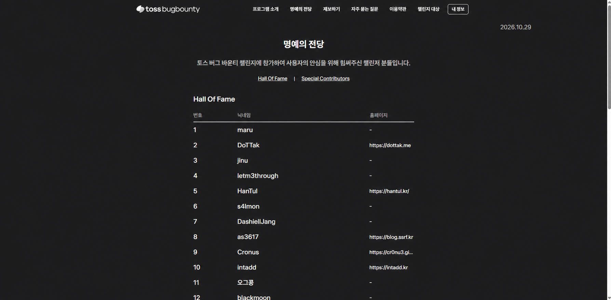

## 활동

- 교내 창업동아리
- **2026** · CES 참관
- **2026~2027** · 한국장학재단 멘토, AI · SW 멘토
- **2027** · 호주 단기 연수

## 수상

- **2025** · 교내 제3회 CTF 최우수상, 메이아이 대표 기업 특별상
- **2026** · 사물인터넷 혁신융합대학 지능 IoT 해커톤 최우수상
- **2026** · CO-SHOW 경진대회 : IoT&AI Innovation 챌린지 장려상(사물인터넷 혁신융합대학사업단 총괄사업단장상)
- **2026** · 교내 The:성장 공모전 금상
- 교내 AI 활용 Scale-Up 기술창업캠프 장려상

## 경진대회 본선

- **2025** · 교육부 주관 SW 개발보안 경진대회(소개딩) 본선
- **2026** · 화이트햇 예선 9등

## CVE

- [`CVE-2026-135150`](https://www.cve.org/CVERecord?id=CVE-2026-135150) · Eclipse Ditto 인증 우회 (Critical)

## 토스 버그바운티

- `TBB-26282`
- `TBB-26362`
- `TBB-26474`
- `TBB-26482`

명예의 전당 사진 보기

_2026.10.29 기준_

